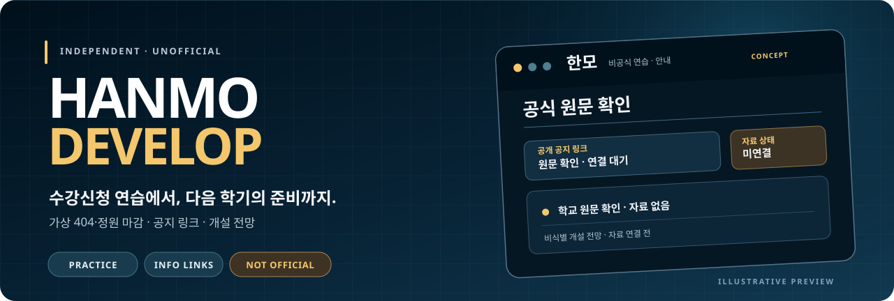
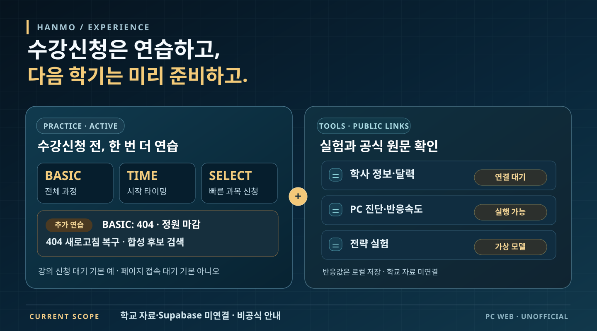
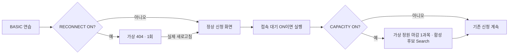
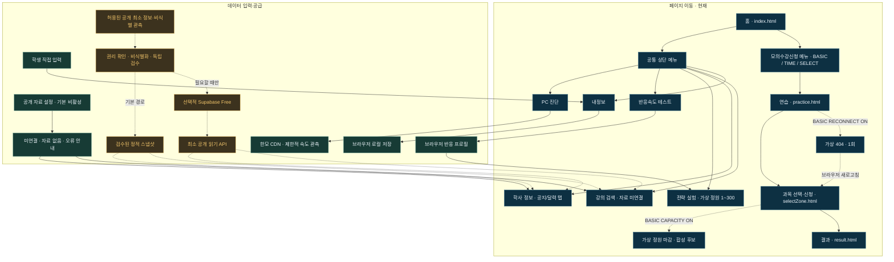

  

  <h1>한모 · Hanmo Develop</h1>

  
<strong>수강신청은 미리 연습하고, 다음 학기는 더 쉽게 준비하고.</strong> 학교와 독립된 비공식 PC 웹 · 모의수강신청 연습과 공개 학사정보 원문 확인

  

    
    
    
    
  

  

    <a href="#experience">한눈에 보기</a> ·
    <a href="#changes">추가된 기능</a> ·
    <a href="#flow">연습 흐름도</a> ·
    <a href="#next">학기 준비</a> ·
    <a href="#site-flow">전체 구조</a>
  

한모의 방향을 표현한 콘셉트 일러스트입니다. 실제 학교 시스템이나 브라우저 화면 캡처가 아닙니다.

> **본 서비스는 한국외국어대학교의 공식 서비스가 아니며, 정확한 정보는 학교 원문을 확인하시기 바랍니다.**
>
> 학교가 운영·인증·제휴·보증하는 서비스가 아닙니다. 실제 수강신청·졸업·신청 기한은 학교의 공식 공지와 학사시스템을 기준으로 확인해야 합니다.

수강신청을 앞두고 학생들이 하는 고민은 신청 버튼을 누르는 순간에만 머물지 않습니다. **어떻게 연습할지, 어떤 공지를 확인해야 할지, 다음 학기의 개설 경향을 어디까지 믿을 수 있을지.** 익숙한 연습 화면에서 출발해 공식 원문으로 이어지는 길을 더 쉽게 찾을 수 있다면 어떨까요?

한모(Hanmo)는 [dlacked/Hanmo](https://github.com/dlacked/Hanmo)의 **BASIC · TIME · SELECT 모의수강신청**을 바탕으로, **PC 진단·반응속도 테스트·전략 실험·학사 정보(공지/달력 통합)·강의 검색·내정보**를 더한 비공식 PC 웹 프로젝트입니다. 합성 모의연습은 동작하지만 학교 공식 학사자료의 자동 수집과 학생용 데이터 연결은 현재 비활성입니다.

## 수강신청은 연습하고, 다음 학기는 미리 준비하고.

### 학생이 한모에서 이어갈 경험

| 궁금한 순간 | 한모에서 이어지는 경험 |
| :--- | :--- |
| **“수강신청 화면이 아직 낯설다면?”** | BASIC·TIME·SELECT로 시작 시각과 신청 순서를 반복 연습 |
| **“학교 공지는 어디서 확인해야 하지?”** | **학사 정보**의 공지 탭에서 미연결 상태를 확인하고 학교 공식 원문으로 이동 *(자료 연동 전)* |
| **“다음 학기 개설 경향을 미리 볼 수 있을까?”** | 허용 자료의 **비식별 집계**로 만드는 한모 자체 비공식 전망 *(자료 연동 전·개별 강좌 확정 아님)* |
| **“자료가 없으면 어떻게 보여 줄까?”** | **미연결·자료 없음·확인 필요**를 구분하고 공식 학교 자료를 직접 확인하도록 안내 |
| **“학교 학사일정은 어디서 확인하지?”** | **학사 정보**의 달력 탭에서 월간 보기와 학교 공식 일정 링크 확인. 임의의 공식 날짜 판정 없음 |

## 원작에서 이어받은 것, 새로 더한 것

| 기존 한모의 경험 | 확장된 경험 |
| :--- | :--- |
| **BASIC · TIME · SELECT** — 전체 신청, 시작 타이밍, 과목 신청 속도 연습 | **BASIC 선택형 돌발상황** — 가상 404는 새로고침으로 복구하고, 가상 정원 마감(`CAPACITY`)은 임의 한 과목 마감 후 합성 대체과목을 조회 |
| **SETTING** — 연습할 과목 수와 기본 신청 대기 | **대기 조건 분리** — 강의 신청 대기 기본 **예**, 신청 페이지 접속 대기 기본 **아니오**. SETTING·돌발상황은 원본 한모의 2칸 예/아니오 UI로 통일(권장 표시 없음) |
| **익숙한 신청 화면과 결과 흐름** | **RECONNECT·CAPACITY 각각 기본 OFF** — 같은 탭 선택을 보존하며 원본 신청/대기/결과 흐름과 실제 학교 자료를 분리 |
| **모의수강신청에 집중한 PC 웹** | **PC 진단·반응속도 테스트·전략 실험·학사 정보(공지/달력 통합)·강의 검색·내정보** — 진단·합성 계산은 동작, 학교 자료는 미연결 |

**보호하는 핵심:** 원작 BASIC/TIME/SELECT의 신청·대기번호·Enter 확인·키보드·결과 흐름을 회귀 기준으로 둡니다. 추가된 두 돌발상황은 모두 **합성 연습**이며 학교 서버·실제 강좌·정원·학생 수강 이력과 연결되지 않습니다. Windows Chrome/Edge 실기기 검증은 아직 별도 과제입니다.

### BASIC 돌발상황, 한눈에 보기

  

RECONNECT와 CAPACITY는 **서로 독립적이며 기본 OFF**입니다. 404는 **실제 브라우저 새로고침**으로 복구하고, CAPACITY는 합성 과목만 사용합니다.

분기 조건 상세 보기 · Mermaid flowchart

뒤로가기는 404 복구 방법으로 지원하지 않습니다. 실제 학교 접속 장애나 정원 마감을 재현하거나 판정하는 기능은 아닙니다.

## 익숙한 연습에서, 학업 준비까지

신청 당일의 타이밍 연습 다음에는 **학교의 공개 공지 원문을 찾고, 불완전한 개설 관측을 학교의 확정 정보와 혼동하지 않는 일**이 남습니다. 한모는 연습 화면에서 비공식 자료 안내와 학교 공식 확인 경로로 자연스럽게 이어지는 경험을 지향합니다.

실제 학사자료의 공개 스냅샷·개설 집계는 **아직 연결되지 않았습니다**. 화면의 존재, 합성 계산 코어, 학교 자료 사용 허가는 서로 다른 상태입니다.

### 지금 이용할 수 있거나 미리 살펴볼 수 있는 화면

| 화면 | 해볼 수 있는 일 | 현재 상태 |
| :--- | :--- | :--- |
| **모의수강신청** · [열기](html/vsugang.html) | BASIC/TIME/SELECT, 기본 OFF인 가상 404·정원 마감, 독립 대기 설정 | **합성 모의연습 가능** · 실제 신청 아님 |
| **내정보** · [열기](html/planner.html) | 캠퍼스·전공·입학년도 직접 입력과 로컬 저장 | **직접 입력 가능** · 학교 학적 미연동 |
| **PC 진단** · [열기](html/readiness.html) | 프레임·타이머 지연과 한모 정적 CDN 응답시간·다운로드 처리량 관측 | **브라우저 관측 가능** · 브라우저 캐시와 확인할 수 없는 전송 표본 제외 |
| **반응속도 테스트** · [열기](html/reaction-test.html) | 시각 신호에 대한 8회 반응 측정, 중앙값 로컬 저장 | **측정 가능** · 전략 실험에 자동 적용 |
| **전략 실험** · [열기](html/strategy-lab.html) | 가상 과목 2~8개(정원 1~300·경쟁자 0~200), 계층적 반응·개인 선호·공통 FCFS 대기열, 1,000회 학습과 별도 조건별 1,000회 평가 | **합성 전략 실험** · 전체/과목별 성공 빈도·기대 성공 과목 수·전원 동시 시작 민감도; 실제 예측 미검증 |
| **학사 정보** · [열기](html/academic-timeline.html) | **공지·월간 달력 탭 통합**, 학교 공식 일정·원문 확인 경로 | 실제 공지·행사 스냅샷 **미연결** · 공식 확정/개인별 마감 판정 아님 |
| **강의 검색** · [열기](html/catalog.html) | 허용·검수된 개설 관측/비식별 집계의 자체 전망 표시를 준비 | **데이터 미연결** · 교수명/수강 관련 정보 제외, [이전 전망 경로](html/forecast.html)는 여기로 이동 |

## 전체 구조 · 화면과 데이터의 연결

모의수강신청에서 시작해 **PC 진단·반응속도·가상 전략 실험·통합 학사 정보·강의 검색으로 이동하는 현재 화면 구성**입니다. 실선은 현재 화면·로컬 입력 경로이고, 점선은 **합성 돌발상황 또는 허용 자료에 한해 별도 검수 후 연결할 데이터 경로**입니다. Supabase는 필수가 아닌 선택지입니다.

학사 공지·개설 전망 화면은 존재하지만 실제 공개 자료 연결은 `mode: disabled`입니다. **학칙·졸업요건(원문 링크·인용·요약·자동 확인 포함), 학교를 대신하는 학사 FAQ, 교수명·수강 관련 정보, 학교 계정·개인 성적 자료는 서비스 대상이 아닙니다.**

### 학교 공개자료 이용 경계

실제 학교 자료 연결은 `mode: disabled`입니다. 정보처의 [서면 회신](docs/sources/2026-11-23-hufs-information-office-reply.txt)에 적힌 금지 항목과 수집 조건을 적용합니다. 운영자가 직원의 대면 설명을 근거로 검토하는 공개정보 가공 범위와 공개 전 검수 절차는 [운영 방침](docs/public-data-operating-decision.md)에 기록합니다.

자동 수집은 **현재 OFF**입니다. 구현 시에도 공지 **하루 1회 이하**(첫 목록+신규 상세), 강의시간표 **학기당 2회 이하**, 요청 간 **10초 이상**·동시 접속 **1개**·실행당 **최대 50건**, 수강신청/정정 기간과 전후 각 **1일 중단**, 오류·접속 제한 발생 **당일 재시도 금지**, 공개 노출 URL·운영자 연락처 포함 User-Agent를 모두 강제해야 합니다. 상세 정책과 기술 게이트는 [아키텍처 §0](docs/architecture.md)에서 관리합니다.

### 개발 및 자동 검증

Node.js **22**에서 `npm ci` → `npm run check` → `npx playwright install chromium` → `npm run test:e2e` 순서로 확인합니다. GitHub Actions의 자동 검사 통과는 Windows Chrome/Edge·NVDA·고배율 실기기 인수나 운영 배포 승인과는 별개입니다.

**현재 개발 기준(2026-11-25):** 전략 실험은 합성 몬테카를로 기반 개인 신청 전략 도구로 현재 기능 구성을 유지하고 안정화·재현성·설명 가능성·민감도 검증을 우선합니다. 실제 학생 선호·진입·경쟁 중복·신청량·서버 처리율은 미보정입니다. 성공률을 높이기 위한 임의 모수 조정이나 추가 분포·제도 비교·실학교 예측을 당장 개발하지 않습니다. 수식 보기에는 39개 MathML 수식과 가정을 표시합니다. 기능 기준 [86c353f](https://github.com/ot4562-glitch/Hanmo_develop/commit/86c353f3c97049c1d5c806e670e6c4faafba103a) (2026-11-25): [Repository checks](https://github.com/ot4562-glitch/Hanmo_develop/actions/runs/45541758615) 통과(보호 해시·`npm run check`·Chromium E2E 포함), [QA Pages](https://github.com/ot4562-glitch/Hanmo_develop/actions/runs/45541758600) 배포 성공, [Feature browser QA](https://github.com/ot4562-glitch/Hanmo_develop/actions/runs/45541758548/job/138961709164) **33/34 통과·1 실패**. `tests/browser-feature.spec.mjs:135`에서 역할 접미사가 추가된 Contributor의 `strong` 전체 문자열을 예전 이름만으로 비교하여 실패합니다. 전략 엔진 실패가 아니며 전체 기능 QA 통과로 기록하지 않습니다.

**개발 역할:** 심민성(`ot4562-glitch`) — 한모(2026) 업데이트 총괄; 이의상(`uisang2004-maker`) — 업데이트 nlp 담당; 김채윤(`qamarrchae`) — 업데이트 데이터 및 품질 보증 담당. 개발자 소개 페이지의 기존 소속·이름을 유지하고 역할을 작은 글씨로 표시합니다.

**현행 협업 과제:** [#134](https://github.com/ot4562-glitch/Hanmo_develop/issues/134)에서 **이의상(`uisang2004-maker`)·김채윤(`qamarrchae`)**이 PC 진단·반응속도·전략 실험의 안정화와 측정·계산 신뢰성을 공동 검증합니다. 세부 후속 과제: [#138](https://github.com/ot4562-glitch/Hanmo_develop/issues/138) 브라우저 QA 회귀 복구(P0), [#139](https://github.com/ot4562-glitch/Hanmo_develop/issues/139) 고정 전략 모형 합성·민감도·성능 검증(P1), [#140](https://github.com/ot4562-glitch/Hanmo_develop/issues/140) 동의 기반 모의연습 및 보정 연구 설계(P2, 별도 승인 전 수집 없음·인수 필수 아님). 원본 연습 결과의 PNG 저장 버튼은 제거했습니다. 열린 협업 PR #120·#130·#131은 수정 요청 상태이고, 본인 Draft #93은 병합하지 않습니다.

**단계·인수 계획:** 2차 모의신청 Windows 실기기 QA([#71](https://github.com/ot4562-glitch/Hanmo_develop/issues/71))가 끝난 다음, 3차 담당 **김채윤(`qamarrchae`)**이 선택적 Supabase Free를 **직접 설치·RLS/권한·백업/복구 실습**합니다([#67](https://github.com/ot4562-glitch/Hanmo_develop/issues/67)). 현재 실제 데이터 연결은 OFF이고 정적 최소 자료가 우선입니다. 전체 프로젝트 완성 후에만 원개발자 **[dlacked/Hanmo](https://github.com/dlacked/Hanmo)**에게 결과물을 전달하고 명시적으로 인수 수락을 확인합니다([#125](https://github.com/ot4562-glitch/Hanmo_develop/issues/125)). 실기기·자료/운영 인수는 아직 완료되지 않았습니다.

[설계 문서](docs/architecture.md) · [문서 안내](docs/README.md) · [개발 이슈](https://github.com/ot4562-glitch/Hanmo_develop/issues) · [라이선스](LICENSE)

---

  
<strong>수강신청을 연습하는 곳에서, 다음 학기를 준비하는 곳으로.</strong>

  Based on <a href="https://github.com/dlacked/Hanmo">dlacked/Hanmo</a> · 비공식 한국외국어대학교 학생 프로젝트 학교 운영·인증·제휴 서비스가 아니며 실제 학교 로그인·수강신청·공식 학사판정을 제공하지 않습니다.

