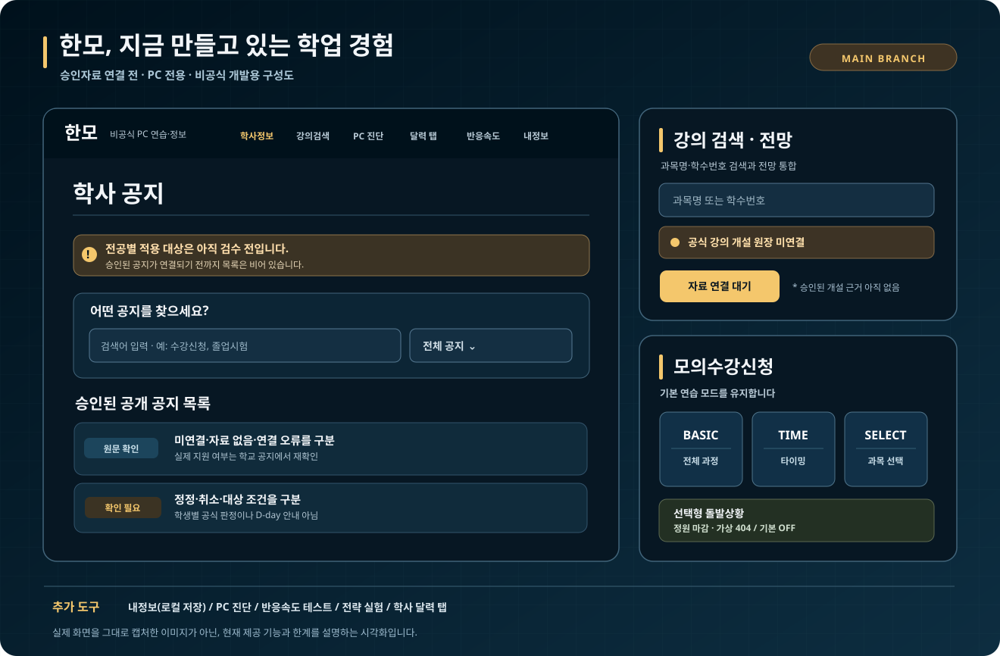
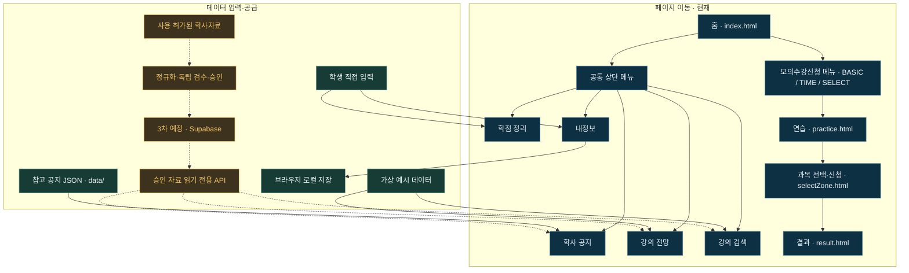

<div align="center">
  <a href="https://github.com/ot4562-glitch/Hanmo_develop"></a>

  <h1>Hanmo Develop</h1>
  <p><strong>수강신청 연습에서, 다음 학기의 준비까지.</strong><br>HUFS · 한국외국어대학교 학생을 위한 비공식 모의수강신청 · 학업 도우미 개발 프로젝트</p>

  <p>
    <a href="https://github.com/ot4562-glitch/Hanmo_develop/actions/workflows/academic-ci.yml"></a>
    <a href="LICENSE"></a>
    
    
  </p>

  <p><a href="#-프로젝트-소개">소개</a> · <a href="#-미리보기">미리보기</a> · <a href="#-기능-현황">기능 현황</a> · <a href="#-로컬-실행">시작하기</a> · <a href="#site-flow">전체 구조</a> · <a href="docs/architecture.md">설계</a> · <a href="https://github.com/ot4562-glitch/Hanmo_develop/issues">이슈</a></p>
</div>


## ✦ 프로젝트 소개

**한모(Hanmo)**는 [원작 한모](https://github.com/dlacked/Hanmo)의 **BASIC · TIME · SELECT 모의수강신청**을 바탕으로, 학생이 학사 공지를 찾아보고 다음 학기를 준비하는 경험까지 확장하는 프로젝트입니다.

**학교가 운영하는 공식 서비스가 아닙니다.** 학교 계정 로그인, 실제 수강신청, 공식 성적·졸업사정과 연동하지 않습니다. 학생용 웹은 **PC 전용**이며, 현재 구현 화면과 검증·운영이 완료된 기능은 서로 구분합니다.

<table>
  <tr>
    <td width="33%"><strong>01 · PRACTICE</strong><br><br>세 가지 모의수강신청 모드로 신청 흐름과 타이밍을 연습합니다.</td>
    <td width="33%"><strong>02 · DISCOVER</strong><br><br>학사 공지 제목과 원문 확인 경로를 살펴보고, 강의 검색 화면의 사용 흐름을 체험합니다.</td>
    <td width="33%"><strong>03 · PREPARE</strong><br><br>강의 개설 근거와 학점 계획을 검토하되, 확인되지 않은 자료는 추정으로 단정하지 않습니다.</td>
  </tr>
</table>

## ◈ 미리보기

[](https://github.com/ot4562-glitch/Hanmo_develop/tree/main/html)

> **미리보기 안내:** 위 이미지는 `main` 브랜치의 현재 기능·화면 구성을 바탕으로 다시 제작한 **설명용 시각화**이며 실제 브라우저 화면 캡처가 아닙니다. 공지의 전공별 적용 대상, 공식 강의 개설 원장, 최신 강좌·교수 데이터는 검수·연결 전입니다. [실제 화면 소스 보기](html/) · [QA 배포 워크플로](.github/workflows/deploy-pages.yml)

## ◇ 기능 현황

| 영역 | 현재 확인할 수 있는 것 | 범위 · 주의사항 |
| :--- | :--- | :--- |
| **모의수강신청** | BASIC / TIME / SELECT 기본 연습 | 원작의 기존 흐름 유지 |
| **돌발상황 연습** | 가상 신청 실패 상태 확인·404 후 복귀 | **두 가지 기본 OFF 옵션** · 대체과목 검색·시간 충돌 시연 코드 제거 · 실제 학교 장애·신청 결과와 무관 |
| **내정보** | 캠퍼스 · 전공 · 입학년도 선택 | **이 브라우저에만 저장**, 학교 계정과 미연동 |
| **학사 공지** | 제목·게시일 중심 검색과 공식 원문 확인 | 전공별 적용 대상과 학생 마감은 검수 전 |
| **강의·교수 검색** | 검색 화면 및 가상 예시 체험 | 검수된 최신 공식 강좌 데이터 미연결 |
| **강의 개설 전망** | 학수번호·학기 기반 근거 확인 UI, 가상 예시 | 실제 개설 원장 미연결 · 미래 개설 확률을 임의 생성하지 않음 |
| **학점 정리** | 직접 입력한 학점 합산 및 학기별 A/B/C 계획 비교 | 공식 이수 판정·졸업 가능 여부 아님 · 비필수 기능 |

**핵심 원칙:** 확인된 사실과 가상 시연을 분리하고, 공지·학칙의 근거와 적용 대상을 확인할 수 없는 경우 **‘확인 필요’**로 남깁니다. 한국어 학사 FAQ, 개설·행사 시기 전망과 졸업 요건 계산 코어는 검증 상태에 따라 별도 확장합니다.

<a id="site-flow"></a>

## ✧ 전체 구조 · 페이지와 데이터 연결

**실선은 현재 페이지 이동·데이터 경로, 점선은 3차 Supabase 연동 목표**입니다. 복잡한 검색 알고리즘 대신 사용자가 어디로 이동하고 자료가 어디에서 들어오는지만 나타냈습니다.



> **현재:** 학사 공지는 `data/academic-notices-reference.json`의 과거 제목 참고 목록을 사용합니다. 강의 검색과 강의 전망에는 가상 예시가 있으며, 내정보는 사용자의 브라우저에만 저장됩니다. **3차 예정:** 학교의 자료 이용 허가와 독립 검수·승인을 거친 구조화 자료만 Supabase에 반입하고 학생 화면에는 공개 읽기 API(장애 시 유효한 정적 스냅샷 대체)를 연결합니다. 학생 성적·개인 계획은 서버에 자동 업로드하지 않습니다.

[실제 페이지 파일](html/) · [자료·Supabase 상세 설계](docs/architecture.md) · [3차 설치 패키지 초안 PR #93](https://github.com/ot4562-glitch/Hanmo_develop/pull/93)

## ◌ 로컬 실행

Node.js 22 환경에서 프로젝트 루트를 기준으로 실행합니다.

```bash
git clone https://github.com/ot4562-glitch/Hanmo_develop.git
cd Hanmo_develop
npm install --ignore-scripts --no-audit --no-fund
npm run check
npm run check:legacy
```

`npm run check`는 TypeScript 타입 검사, 계산 코어 테스트, 정적 빌드와 페이지 검증을 실행합니다. `npm run check:legacy`는 원래 모의신청과 PC 제한 동작을 별도로 검증합니다. 빌드 산출물은 `dist/`에 생성됩니다. 브라우저에서 확인할 때는 로컬 HTTP 서버로 `dist/`를 제공하세요.

<details>
<summary><strong>디렉터리와 개발 단계 보기</strong></summary>

| 경로 | 역할 |
| :--- | :--- |
| `html/` · `css/` | 학생용 정적 화면과 한모 디자인 |
| `js/academic/` | TypeScript 학업 계산 코어 및 계약 |
| `js/` | 기존 모의신청 JavaScript와 화면 로직 |
| `data/` | 검토·참고용 학사 자료 스냅샷 |
| `tests/` · `scripts/` | 회귀 테스트, 빌드 및 검증 도구 |
| `docs/architecture.md` | **현행 제품·기술 설계의 기준 문서** |

**개발 4단계:** ① TypeScript + 정적 HTML/CSS 학업 플랫폼 → ② 원개발자 협의 후 기존 JS 모의신청 시나리오 확장 → ③ 승인 책임자가 운영하는 Supabase 실연동·검증 → ④ 동등성 검증 후 JavaScript/JSDoc으로 점진적 통일. 단계와 승인 조건은 [아키텍처](docs/architecture.md)에서 관리합니다.

</details>

---

<div align="center">
  <p><strong>공식 학사정보는 반드시 한국외국어대학교의 원문 공지로 다시 확인하세요.</strong></p>
  <p>
    <a href="docs/architecture.md">Architecture</a> ·
    <a href="agent.md">Contribution Guide</a> ·
    <a href="https://github.com/ot4562-glitch/Hanmo_develop/issues">Issues</a> ·
    <a href="LICENSE">GPL-3.0 License</a>
  </p>
  <sub>Based on <a href="https://github.com/dlacked/Hanmo">dlacked/Hanmo</a> · Unofficial HUFS student project · Not affiliated with HUFS</sub>
</div>
