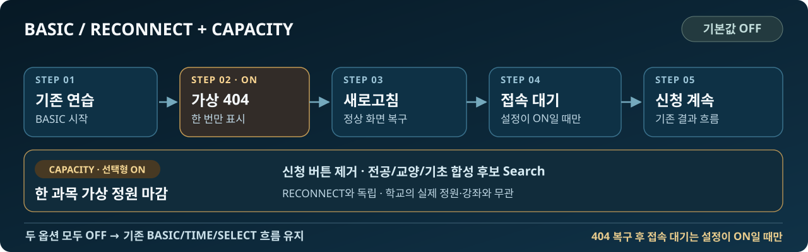
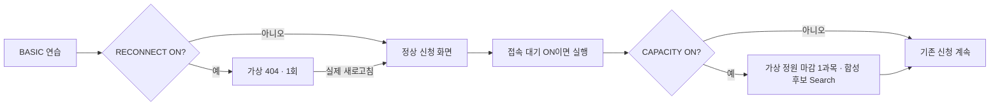
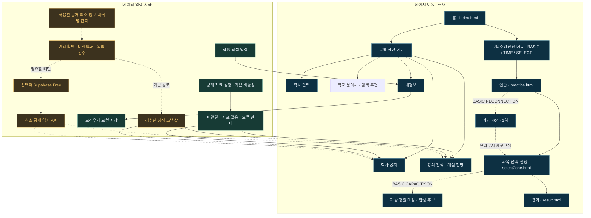

  

  <h1>한모 · Hanmo Develop</h1>

  
<strong>수강신청은 미리 연습하고, 다음 학기는 더 쉽게 준비하고.</strong> 학교와 독립된 비공식 PC 웹 · 모의수강신청 연습과 공개 학사정보 원문 확인

  

    
    
    
    
  

  

    <a href="#experience">한눈에 보기</a> ·
    <a href="#changes">추가된 기능</a> ·
    <a href="#flow">연습 흐름도</a> ·
    <a href="#next">학기 준비</a> ·
    <a href="#site-flow">전체 구조</a>
  

한모의 방향을 표현한 콘셉트 일러스트입니다. 실제 학교 시스템이나 브라우저 화면 캡처가 아닙니다.

> **본 서비스는 한국외국어대학교의 공식 서비스가 아니며, 정확한 정보는 학교 원문을 확인하시기 바랍니다.**
>
> 학교가 운영·인증·제휴·보증하는 서비스가 아닙니다. 실제 수강신청·졸업·신청 기한은 학교의 공식 공지와 학사시스템을 기준으로 확인해야 합니다.

수강신청을 앞두고 학생들이 하는 고민은 신청 버튼을 누르는 순간에만 머물지 않습니다. **어떻게 연습할지, 어떤 공지를 확인해야 할지, 다음 학기의 개설 경향을 어디까지 믿을 수 있을지.** 익숙한 연습 화면에서 출발해 공식 원문으로 이어지는 길을 더 쉽게 찾을 수 있다면 어떨까요?

한모(Hanmo)는 [dlacked/Hanmo](https://github.com/dlacked/Hanmo)의 **BASIC · TIME · SELECT 모의수강신청**을 바탕으로, **공개 공지의 공식 원문 링크·한모 자체 비식별 개설 전망·달력·학교 문의처 검색**을 잇는 비공식 PC 웹 프로젝트입니다. 합성 모의연습은 동작하지만 학교 공식 학사자료의 자동 수집과 학생용 데이터 연결은 현재 비활성입니다.

## 수강신청은 연습하고, 다음 학기는 미리 준비하고.

### 학생이 한모에서 이어갈 경험

| 궁금한 순간 | 한모에서 이어지는 경험 |
| :--- | :--- |
| **“수강신청 화면이 아직 낯설다면?”** | BASIC·TIME·SELECT로 시작 시각과 신청 순서를 반복 연습 |
| **“학교 공지는 어디서 확인해야 하지?”** | 공지 화면에서 공개자료 상태를 확인하고 **학교 공식 원문 링크**로 이동 *(자료 연동 전)* |
| **“다음 학기 개설 경향을 미리 볼 수 있을까?”** | 허용 자료의 **비식별 집계**로 만드는 한모 자체 비공식 전망 *(자료 연동 전·개별 강좌 확정 아님)* |
| **“자료가 없으면 어떻게 보여 줄까?”** | **미연결·자료 없음·확인 필요**를 구분하고 공식 학교 자료를 직접 확인하도록 안내 |
| **“학교 학사일정은 어디서 확인하지?”** | 월간 **학사 달력·학교 공식 일정 링크**로 연결. 학사 제도 FAQ는 대신 답변하지 않음 |

## 원작에서 이어받은 것, 새로 더한 것

| 기존 한모의 경험 | 확장된 경험 |
| :--- | :--- |
| **BASIC · TIME · SELECT** — 전체 신청, 시작 타이밍, 과목 신청 속도 연습 | **BASIC 선택형 돌발상황** — 가상 404는 새로고침으로 복구하고, 가상 정원 마감(`CAPACITY`)은 임의 한 과목 마감 후 합성 대체과목을 조회 |
| **SETTING** — 연습할 과목 수와 기본 신청 대기 | **대기 조건 분리** — 강의 신청 대기 기본 **예**, 신청 페이지 접속 대기 기본 **아니오**. SETTING·돌발상황은 원본 한모의 2칸 예/아니오 UI로 통일(권장 표시 없음) |
| **익숙한 신청 화면과 결과 흐름** | **RECONNECT·CAPACITY 각각 기본 OFF** — 같은 탭 선택을 보존하며 원본 신청/대기/결과 흐름과 실제 학교 자료를 분리 |
| **모의수강신청에 집중한 PC 웹** | **내정보·학사공지·개설 전망(검색 화면 통합)·학사 달력** — 직접 입력은 로컬 저장, 공개 데이터는 아직 미연결 |

**보호하는 핵심:** 원작 BASIC/TIME/SELECT의 신청·대기번호·Enter 확인·키보드·결과 흐름을 회귀 기준으로 둡니다. 추가된 두 돌발상황은 모두 **합성 연습**이며 학교 서버·실제 강좌·정원·학생 수강 이력과 연결되지 않습니다. Windows Chrome/Edge 실기기 검증은 아직 별도 과제입니다.

### BASIC 돌발상황, 한눈에 보기

  

RECONNECT와 CAPACITY는 **서로 독립적이며 기본 OFF**입니다. 404는 **실제 브라우저 새로고침**으로 복구하고, CAPACITY는 합성 과목만 사용합니다.

분기 조건 상세 보기 · Mermaid flowchart

뒤로가기는 404 복구 방법으로 지원하지 않습니다. 실제 학교 접속 장애나 정원 마감을 재현하거나 판정하는 기능은 아닙니다.

## 익숙한 연습에서, 학업 준비까지

신청 당일의 타이밍 연습 다음에는 **학교의 공개 공지 원문을 찾고, 불완전한 개설 관측을 학교의 확정 정보와 혼동하지 않는 일**이 남습니다. 한모는 연습 화면에서 비공식 자료 안내와 학교 공식 확인 경로로 자연스럽게 이어지는 경험을 지향합니다.

실제 학사자료의 공개 스냅샷·개설 집계는 **아직 연결되지 않았습니다**. 화면의 존재, 합성 계산 코어, 학교 자료 사용 허가는 서로 다른 상태입니다.

### 지금 이용할 수 있거나 미리 살펴볼 수 있는 화면

| 화면 | 해볼 수 있는 일 | 현재 상태 |
| :--- | :--- | :--- |
| **모의수강신청** · [열기](html/vsugang.html) | BASIC/TIME/SELECT, 기본 OFF인 가상 404·정원 마감, 독립 대기 설정 | **합성 모의연습 가능** · 실제 신청 아님 |
| **내정보** · [열기](html/planner.html) | 캠퍼스·전공·입학년도 직접 입력과 로컬 저장 | **직접 입력 가능** · 학교 학적 미연동 |
| **학사 공지** · [열기](html/academic-timeline.html) | 허용된 공개 공지의 최소 안내와 **공식 원문 링크** 제공 준비 | 실제 공지 스냅샷 **미연결** · 검색칸과 안내·버튼 왼쪽 정렬 · 본문/첨부 복제하지 않음 |
| **강의 검색·개설 전망** · [열기](html/catalog.html) | 허용된 비식별 관측 집계의 **한모 자체 전망**을 표시할 준비 | 데이터 **미연결** · 검색칸과 안내·버튼 왼쪽 정렬 · 교수/수강 관련·개별 분반 상세 제외, [기존 전망 경로](html/forecast.html)는 여기로 이동 |
| **학사 달력** · [열기](html/academic-calendar.html) | 월간 달력과 **학교 공식 일정 링크** | 학교 일정을 자동 확정·대신 안내하지 않음 |
| **학교 문의처** · [열기](html/academic-support.html) | 문의 주제 입력·검색어 추천·구글에서 `한국외국어대학교 + 검색어`로 검색 | 학교 부서·전화·이메일·위치 **미보유**, 검색 결과는 공식 사이트만으로 제한되지 않음. 외부 링크를 열기 전에는 검색어를 전송하지 않음 |

## 전체 구조 · 화면과 데이터의 연결

모의수강신청에서 시작해 **공지 링크·비공식 개설 전망·달력·문의처 검색으로 이동하는 현재 화면 구성**입니다. 실선은 현재 화면·로컬 입력 경로이고, 점선은 **합성 돌발상황 또는 허용 자료에 한해 별도 검수 후 연결할 데이터 경로**입니다. Supabase는 필수가 아닌 선택지입니다.

학사 공지·개설 전망 화면은 존재하지만 실제 공개 자료 연결은 `mode: disabled`입니다. **학칙·졸업요건(원문 링크·인용·요약·자동 확인 포함), 학교를 대신하는 학사 FAQ, 교수명·수강 관련 정보, 학교 계정·개인 성적 자료는 서비스 대상이 아닙니다.**

### 학교 공개자료 이용 경계

[한국외대 정보처의 2026-11-23 서면 회신](docs/sources/2026-11-23-hufs-information-office-reply.txt)에 따라, 로그인 없이 공개된 자료도 **공지의 최소 안내·공식 원문 링크** 및 허용된 **비식별 개설 집계**에만 사용합니다. 학교가 별도 과거 학기 목록·파일·API를 제공하거나 한모를 승인한 것은 아닙니다.

자동 수집은 **현재 OFF**입니다. 구현 시에도 공지 **하루 1회 이하**(첫 목록+신규 상세), 강의시간표 **학기당 2회 이하**, 요청 간 **10초 이상**·동시 접속 **1개**·실행당 **최대 50건**, 수강신청/정정 기간과 전후 각 **1일 중단**, 오류·접속 제한 발생 **당일 재시도 금지**, 공개 노출 URL·운영자 연락처 포함 User-Agent를 모두 강제해야 합니다. 상세 정책과 기술 게이트는 [아키텍처 §0](docs/architecture.md)에서 관리합니다.

### 개발 및 자동 검증

Node.js **22**에서 `npm ci` → `npm run check` → `npx playwright install chromium` → `npm run test:e2e` 순서로 확인합니다. GitHub Actions의 자동 검사 통과는 Windows Chrome/Edge·NVDA·고배율 실기기 인수나 운영 배포 승인과는 별개입니다.

**단계·인수 계획:** 2차 모의신청 Windows 실기기 QA([#71](https://github.com/ot4562-glitch/Hanmo_develop/issues/71))가 끝난 다음, 3차 담당 **김채윤(`qamarrchae`)**이 선택적 Supabase Free를 **직접 설치·RLS/권한·백업/복구 실습**합니다([#67](https://github.com/ot4562-glitch/Hanmo_develop/issues/67)). 현재 실제 데이터 연결은 OFF이고 정적 최소 자료가 우선입니다. 전체 프로젝트 완성 후에만 원개발자 **[dlacked/Hanmo](https://github.com/dlacked/Hanmo)**에게 결과물을 전달하고 명시적으로 인수 수락을 확인합니다([#125](https://github.com/ot4562-glitch/Hanmo_develop/issues/125)). 실기기·자료/운영 인수는 아직 완료되지 않았습니다.

[설계 문서](docs/architecture.md) · [문서 안내](docs/README.md) · [개발 이슈](https://github.com/ot4562-glitch/Hanmo_develop/issues) · [라이선스](LICENSE)

---

  
<strong>수강신청을 연습하는 곳에서, 다음 학기를 준비하는 곳으로.</strong>

  Based on <a href="https://github.com/dlacked/Hanmo">dlacked/Hanmo</a> · 비공식 한국외국어대학교 학생 프로젝트 학교 운영·인증·제휴 서비스가 아니며 실제 학교 로그인·수강신청·공식 학사판정을 제공하지 않습니다.

